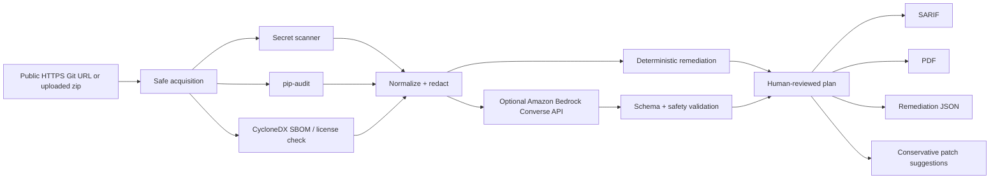

# Repo Doctor - Deterministic Code Risk Scanner + Bedrock Remediation

Repo Doctor scans a public Git repository or uploaded zip for likely credentials, vulnerable Python dependencies, SBOM/license risks, and then produces reviewable remediation artifacts.

The security design is deliberately split in two:

1. **Deterministic scanners are the source of truth.** Regex rules, `pip-audit`, and CycloneDX produce findings.
2. **Amazon Bedrock is optional and advisory.** It receives only normalized, redacted findings and proposes a human-reviewed remediation plan. It never receives repository source code or raw credential values, and it never executes fixes.

## Why this design

LLMs are useful for explaining findings and sequencing remediation, but they should not be trusted to discover or silently apply security fixes. Repo Doctor keeps detection, evidence, and verification deterministic while using an LLM only as a constrained planning layer.

## Architecture



## Five-minute evidence-first demo (no AWS account required)

Use the **PR branch** so the demo uses the updated scanner rather than the older `main` branch:

```bash
git clone --branch aws-bedrock-remediation-eval https://github.com/Shadman19/repo-doctor.git
cd repo-doctor
python3 -m venv .venv
source .venv/bin/activate
python -m pip install -r requirements.txt -r requirements-dev.txt

# Check the reproducible local behavior before presenting results
python -m pytest -q
python -m agent.evaluation --output benchmark-results.local.json

# Optional UI walkthrough: keep Bedrock OFF for the offline demo
streamlit run app.py
```

**What to demonstrate in the UI:** scan a small **public** test repository or a deliberately synthetic ZIP. Point to the normalized findings with file/line information and redacted evidence, then show the human-reviewed remediation recommendations. Export the **SARIF**, **PDF**, **remediation JSON** and conservative patch recommendations. Neither the report nor the language model should receive a real credential. The UI has a Bedrock toggle, but live AWS validation is not part of the checked results.

**What the results actually show:** The [saved results](benchmarks/results.json) cover **14 synthetic cases** (8 expected detections, 6 negative controls). This regression set gives 8 true positives, 0 false positives and 0 false negatives, with **1.000 precision, recall and F1** and passing raw-value redaction. Local `pytest` also passed **13/13 tests**. These are controlled software tests, **not** a measure of field performance or a claim that Bedrock has been used with a live AWS account.

### 60-second technical explanation

> Repo Doctor treats security detection and AI-based remediation as separate trust boundaries. Conventional scanners detect potential exposed credentials and dependency or licensing issues; findings are normalized and redacted before any optional Bedrock call. Bedrock can suggest actions and verification steps, but the response must match known finding IDs and a constrained format. Invalid or missing suggestions fall back to deterministic guidance. Fixes are never auto-applied. I tested the scanner and controls using a reproducible synthetic regression suite; real-world detection accuracy and live Bedrock operation are still unvalidated.

### Why this is an Applied Scientist project, not just an interface

The central research question is whether an LLM can make **security findings more actionable without becoming the source of truth**. The current prototype defines measurable controls (finding coverage, false positives/false negatives on a fixed synthetic set, data minimization and schema validation). Next evaluation steps would use independent, permissioned open-source vulnerability corpora, blinded human review of fix quality, cost/latency measurements and prompt-injection attacks against attacker-controlled metadata. Those expanded studies **have not yet been completed**.

## Security controls

- Raw secret matches and source lines are never returned by the scanner; findings contain a redacted value and SHA-256 fingerprint prefix. Neither value is included in the Bedrock request.
- Zip extraction rejects traversal and symlink entries and enforces entry-count and uncompressed-size limits.
- Git acquisition accepts only public `https://` URLs from an allow-list of common Git hosts.
- Large/binary files and dependency directories are skipped.
- Bedrock receives only normalized metadata and redacted evidence.
- Bedrock output is parsed as JSON, restricted to existing finding IDs, checked for required verification steps, and never auto-applied.
- If Bedrock fails or returns invalid output, Repo Doctor falls back to deterministic guidance.
- Remediation is always marked `auto_apply: false`.

## What it checks

- **Possible secrets:** AWS keys, Google API keys, Slack tokens, GitHub PATs, private-key headers, Stripe keys, and common literal `secret_key` assignments.
- **Python dependency vulnerabilities:** `pip-audit` against `requirements.txt`.
- **SBOM:** CycloneDX JSON for Python requirements when supported by the installed tool version.
- **License policy flags:** optional GPL/AGPL detection from top-level license files.

## Outputs

- SARIF 2.1.0 for code-scanning systems
- PDF executive report
- JSON remediation plan
- CycloneDX SBOM when available
- conservative unified-diff suggestions

## Run locally

```bash
python -m venv .venv
source .venv/bin/activate
python -m pip install -r requirements.txt
streamlit run app.py
```

## Optional Amazon Bedrock setup

Repo Doctor uses the Bedrock Runtime **Converse API**, which provides a consistent messages interface across supported models. AWS documents that Converse requires the `bedrock:InvokeModel` permission.

Set credentials through the standard AWS SDK chain (for example, an AWS profile, environment variables, or an instance/task role). Do not place credentials in the repository.

```bash
export AWS_PROFILE=my-profile
export AWS_REGION=us-east-1
export REPO_DOCTOR_BEDROCK_MODEL_ID='your-model-id-or-inference-profile-arn'
streamlit run app.py
```

Minimal starting IAM policy for one approved model or inference profile:

```json
{
  "Version": "2012-10-17",
  "Statement": [
    {
      "Effect": "Allow",
      "Action": "bedrock:InvokeModel",
      "Resource": "YOUR_APPROVED_MODEL_OR_INFERENCE_PROFILE_ARN"
    }
  ]
}
```

Use least privilege and narrow the resource to the approved model/inference profile wherever your AWS setup supports it. Optional Bedrock Guardrail ID and version can be supplied in the UI.

## Deterministic benchmark

Run:

```bash
python -m agent.evaluation --output benchmarks/results.json
```

Current regression result on the bundled synthetic benchmark:

| Metric | Result |
|---|---:|
| Cases | 14 |
| Expected findings | 8 |
| Precision | 1.000 |
| Recall | 1.000 |
| F1 | 1.000 |
| Raw-secret redaction check | Pass |
| Remediation coverage | 1.000 |

These are synthetic regression results, not a claim of production detection performance. The benchmark intentionally excludes live dependency-vulnerability accuracy because advisory databases change over time.

## Tests

```bash
python -m pip install -r requirements-dev.txt
pytest -q
```

The suite covers redaction, line/column location, false-positive controls, zip traversal rejection, deterministic remediation coverage, Bedrock response validation with a fake client, fallback behavior, benchmark thresholds, and report generation.

## Threat model and limitations

See [docs/threat-model.md](docs/threat-model.md) and [docs/aws-architecture.md](docs/aws-architecture.md).

Important limitations:

- Regex secret detection can miss obfuscated or novel credential formats and can produce false positives.
- `pip-audit` results depend on the current advisory database and dependency resolution.
- License checks are policy indicators, not legal advice.
- Bedrock-generated guidance can be wrong; deterministic scanner evidence and human review remain authoritative.
- Repo Doctor is a research/engineering prototype, not a replacement for enterprise secret scanning, SAST, software-composition analysis, or incident response.

## Reviewer-friendly case study

For the engineering question, trust boundaries, reproducible measurements, and outstanding evaluation gaps, read the [short security case study](docs/security-case-study.md).

## References

- Amazon Bedrock Converse API: https://docs.aws.amazon.com/boto3/latest/reference/services/bedrock-runtime/client/converse.html
- Amazon Bedrock preventative security best practices: https://docs.aws.amazon.com/bedrock/latest/userguide/security-best-practice-agents.html
- Amazon Bedrock Guardrails: https://docs.aws.amazon.com/bedrock/latest/userguide/guardrails.html
