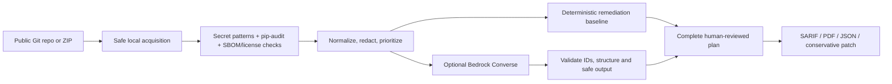

# Repo Doctor v2: AI-Assisted Repository Security Without Auto-Fix

**Role-relevant engineering case study | Research and prototype status (October 2026)**

**Problem.** A security assistant should help developers prioritize and understand findings without letting a language model invent vulnerabilities, leak sensitive evidence, or apply unreviewed changes.

**Hypothesis.** Combining deterministic scanners with an optional, constrained model for explanations can make remediation more actionable while preserving a clear boundary between evidence and advice. This is an engineering hypothesis; a human usefulness study has not yet been conducted.

## System at a glance



**Trust boundaries.** Repository input and scanner text are untrusted; raw credential values are redacted before output. Only limited, normalized finding metadata is eligible for the optional Bedrock call. An LLM response must reference existing findings and include verification steps; incomplete suggestions fall back to deterministic guidance. `auto_apply` is always false. AWS credentials are supplied through the SDK credential chain, not committed to the repository.

## Reproducible demo

```bash
git clone --branch aws-bedrock-remediation-eval https://github.com/Shadman19/repo-doctor.git
cd repo-doctor
python3 -m venv .venv
source .venv/bin/activate
python -m pip install -r requirements.txt -r requirements-dev.txt
python -m pytest -q
python -m agent.evaluation --output benchmark-results.local.json
streamlit run app.py
```

Open the Streamlit app and choose a **small public repository** or a **synthetic ZIP**, with **Use Amazon Bedrock** unchecked. Inspect redacted findings and human-review remediation actions; export SARIF, the PDF report and remediation JSON.

### Measured evidence and scope

| Check | Evidence | Scope |
|---|---|---|
| Unit tests | **13/13 pass** (local, confirmed by repository owner) | Scanner, redaction, response validation, fallback, reports |
| GitHub Actions | CI succeeded for the initial v2 PR commit | Automated Python tests + synthetic benchmark |
| Secret benchmark | **14 cases: 8 positives, 6 negatives** | Small fixed synthetic regression suite |
| Detection | TP=8, FP=0, FN=0; precision/recall/F1=1.000 | **Not** production accuracy |
| Raw-value redaction | Pass | Synthetic values in serialized scanner output |
| Remediation coverage | 1.000 | Every normalized finding gets baseline guidance |
| Bedrock runtime | **Not tested against a live AWS account** | Fake-client tests of interface and validation |

Saved benchmark: [`benchmarks/results.json`](../benchmarks/results.json). Implementation and other limitations: [README](../README.md), [architecture](aws-architecture.md), [threat model](threat-model.md).

### Failure analysis and next experiments

- **Detection gaps:** regex rules can miss obfuscated credentials or flag harmless dummy strings; dependency and license coverage is partial.
- **Evaluation gaps:** synthetic regression success does not establish real-world precision, recall, exploitability, or patch quality.
- **LLM risks:** prompt injection in metadata, malformed JSON, invented claims or unsafe suggestions remain possible despite schema checks.
- **Next experiment (not yet run):** curated permissioned/open-source repository corpus; blind review of actionable fixes; verified patch success, false-positive burden, cost, latency and ablations (deterministic-only vs Bedrock).
- **Operational boundary:** never execute model suggestions automatically; require human approval and project-specific tests.

## What this demonstrates

A functioning security-oriented software prototype with reproducible Python tests, threat modeling, data minimization, deterministic baseline design, optional LLM integration, and clear separation between **measured evidence** and **unvalidated aspirations**. It is not a deployed commercial scanner or an empirical proof of Bedrock-assisted remediation benefit.
